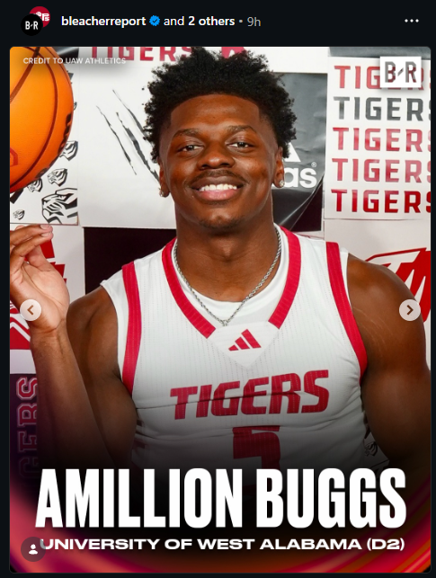

# Hi there, I'm Deepankar 👋

I'm a software engineer from India. I work on backend systems, data pipelines, and developer tools. I like finding the actual bottleneck, working out whether we need more infrastructure, and simplifying things where we can.

❤️ Outside work: table tennis, badminton, and the occasional internet rabbit hole.

## 🤖 Working with agents

I work with coding agents and build tooling around them, including context inspection, local secret redaction, and recovery when integrations fail.

Much of that is harness engineering: task scope, context, tool permissions, and feedback from tests. More context can add cost and latency without helping; some steps are better handled by ordinary code than another model call.

Agents can handle more implementation, but I still need to decide whether the design fits, how it should run, and what the change could break.

Shipping faster makes regression checks more important. I keep changes small enough to review, test existing behavior and failure paths, and check generated tests as well as generated code—they can share the same wrong assumption. For bug fixes, I want the regression test to fail on the old code, not just pass on the fix.

## 🧰 From my workbench to yours

**[tivr.dev](https://tivr.dev)** is my collection of browser tools for those small, everyday tasks: formatting JSON, comparing text, querying Parquet files, or cleaning up an image.

The tools process your inputs in your browser, so they stay on your device. No signup, no ads, no uploading a file just to get a quick thing done.

**[Open the workbench →](https://tivr.dev)**

## 💻 Tools I reach for

<table align="center">
  <tr>
    <td align="center" width="96">
      
       Python
    </td>
    <td align="center" width="96">
      
       Django
    </td>
    <td align="center" width="96">
      
       TypeScript
    </td>
    <td align="center" width="96">
      
       React
    </td>
    <td align="center" width="96">
      
       AWS
    </td>
    <td align="center" width="96">
      
       REST API
    </td>
    <td align="center" width="96">
      
       GraphQL
    </td>
    <td align="center" width="96">
      
       PostgreSQL
    </td>
  </tr>
  <tr>
    <td align="center" width="96">
      
       Node.js
    </td>
    <td align="center" width="96">
      
       Redis
    </td>
    <td align="center" width="96">
      
       Docker
    </td>
    <td align="center" width="96">
      
       Tailwind
    </td>
    <td align="center" width="96">
      
       GitHub
    </td>
    <td align="center" width="96">
      
       VS Code
    </td>
    <td align="center" width="96">
      
       Postman
    </td>
    <td align="center" width="96">
      
       Linux
    </td>
  </tr>
  <tr>
    <td align="center" width="96">
      
       Rust
    </td>
    <td align="center" width="96">
      
       FastAPI
    </td>
    <td align="center" width="96">
      
       Next.js
    </td>
    <td align="center" width="96">
      
       Vite
    </td>
    <td align="center" width="96">
      
       NGINX
    </td>
    <td align="center" width="96">
      
       SQLite
    </td>
    <td align="center" width="96">
      
       Raspberry Pi
    </td>
    <td align="center" width="96">
      
       Markdown
    </td>
  </tr>
</table>

---

  

<picture>
  <source media="(prefers-color-scheme: dark)" srcset="https://raw.githubusercontent.com/cquark7/cquark7/output/github-contribution-grid-snake-dark.svg" />
  
</picture>

### ✍️ Random Dev Quote

### 🤠 Random Meme

  

---

🤝 Always happy to talk about system design, infrastructure trade-offs, getting more out of agents, or your latest rabbit hole.

[Website](https://me.tivr.dev) · [LinkedIn](https://www.linkedin.com/in/deepankar-sharma/) · [Twitter](https://twitter.com/geeky_lad/) · [Email](mailto:hello@tivr.dev)
